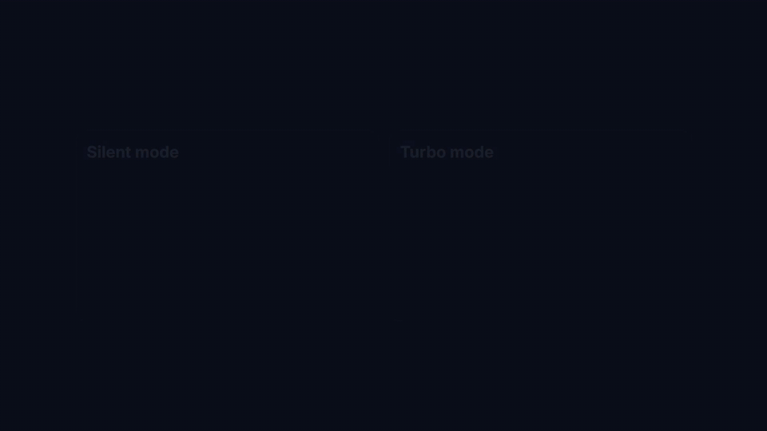
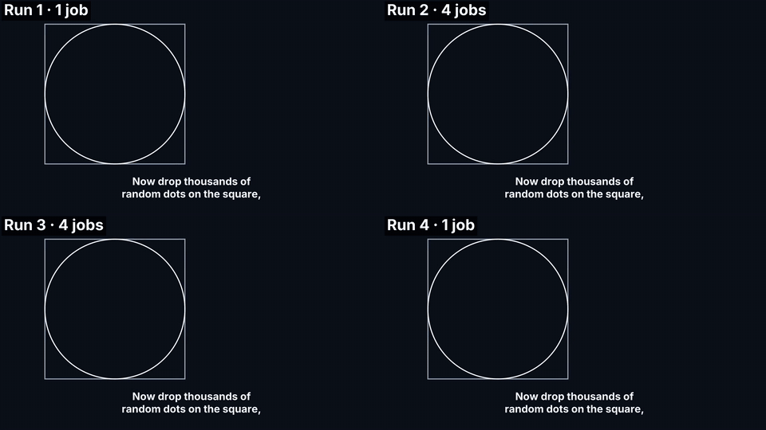

# PolyCue Studio

[](https://github.com/Mateo-RR/polycue/actions/workflows/ci.yml)

**Ask for an explainer video in one sentence. A coding agent writes the script, records the voiceover, builds each scene in Manim or Remotion, checks the frames and hands you a finished, subtitled MP4, in the language you ask for.**


*The demo above was produced by the studio itself, with no manual editing. Its source is included in the repo as an example ([`studio_showcase`](#example-project)).*

## What it does

- **Two engines, one video.** Each scene is rendered with the engine that suits it: [Manim](https://www.manim.community/) for math, formulas and simulations; [Remotion](https://www.remotion.dev/) for kinetic typography, diagrams and UI. The cuts between them are invisible.
- **Audio first.** The voiceover is generated before any animation, and every animation waits for a cue word in the narration, so visuals stay in sync with the voice to the frame.
- **Cheap translations.** Scene code contains no text: narration and on-screen strings live in per-language files. A new language is a translation plus a mechanical re-render, and the voice speed can be adjusted so each scene keeps its original length. Scenes without text can be rendered once and reused in every language, as long as their timing matches.
- **Cheap edits.** Changing a finished video only redoes what changed: fixing a sentence regenerates the voice and render of that scene alone, and the agent follows a cost table (`docs/LOCALIZATION.md`) to pick the cheapest way to apply each change.
- **Subtitles without re-rendering.** Word-timed subtitles, burned in or as a separate track. A subtitle zone is always kept clear, so you can add them at any time.
- **Self-checking.** The agent extracts keyframes with safe-area overlays, inspects them and fixes broken layouts before the final render.
- **Parallel rendering.** Several scenes render at once, so rendering a one-minute video takes less than half the time on a 6-core laptop ([numbers below](#parallel-rendering)).
- **Vertical or horizontal**, for Shorts/Reels/TikTok or YouTube.

The repo is written as an **executable spec** for [Claude Code](https://claude.com/claude-code): `CLAUDE.md` and `docs/` describe how to build the studio from scratch and how to produce a video, and the agent follows them.

## Quickstart

**Requirements:** Python ≥ 3.12, Node ≥ 18, ffmpeg with libass, and a LaTeX distribution (for Manim's formulas). On Linux, also Cairo + Pango. Check everything at once with:

```bash
python scripts/doctor.py   # lists what is missing and how to install it on your OS
```

### With Claude Code (intended workflow)

```bash
git clone https://github.com/Mateo-RR/polycue.git && cd polycue
claude
> Set up the studio            # installs the pinned dependencies and runs an end-to-end smoke test
> Make a 60-second video about Bayes' theorem for YouTube
> Now make a Spanish version
```

### Manual

The scripts also work without the agent, for a project whose script and scenes are already written (like the included example):

```bash
PY=manim_engine/.venv/bin/python        # Windows: manim_engine\.venv\Scripts\python
$PY scripts/tts_sync.py  --slug studio_showcase --lang en-US                  # voiceover + timings
$PY scripts/render.py    --slug studio_showcase --lang en-US --preview        # fast preview
$PY scripts/qa_frames.py --slug studio_showcase --lang en-US --preview --at-cues
$PY scripts/render.py    --slug studio_showcase --lang en-US                  # final render
$PY scripts/stitch.py    --slug studio_showcase --lang en-US --subs burn      # → projects/studio_showcase/output/
```

Set up the environment first by following `docs/SETUP.md` (section "Shortcut").

## How it works

```text
narration.json ──► tts_sync.py ──► audio/*.mp3 + timings.json (durations, cue frames, word times)
                                          │
manifest.json (engine per scene) ──► render.py ──► Manim clips ─┐  scenes render in parallel
                                          │       Remotion clips ┤  clean: no audio, no subtitles
                                          ▼                      │
                                   qa_frames.py (agent QA loop)  │
                                                                 ▼
                         stitch.py: normalize + mux voice + concat + loudnorm + subtitles ──► projects/<slug>/output/*.mp4
```

### Why not just use manim-voiceover or Remotion's agent skills?

The building blocks already exist, and this project uses them where they fit. [`manim-voiceover`](https://pypi.org/project/manim-voiceover/) syncs narration inside Manim, and Remotion ships [agent skills](https://github.com/remotion-dev/skills) for Claude Code. Each of them stays inside its own engine. What this repo adds is the layer that makes the two engines work as one production pipeline:

| Problem | How it is solved here |
|---|---|
| Two engines must look like one | A single `shared/theme.json` drives Manim, Remotion **and** the subtitle renderer. Every scene starts and ends on a clean background. `stitch.py` re-encodes both engines' BT.601 output to tagged BT.709, so colors match when one engine cuts to the other. |
| Animations drift from the voice | `tts_sync.py` reads word-boundary events from the TTS to find each `[[cue]]` marker in the narration. Scenes wait for cues, not for hard-coded seconds. `SyncedScene` compensates for Manim's frame rounding, so every clip is **frame-exact**, and `render.py` / `stitch.py` verify frame counts. |
| Translations usually mean re-doing the video | Strings and narration live in `locales/<lang>/`. `--fit-to <lang>` adjusts the speech rate of a translated voice (±15 %) so each scene keeps the source duration. Narration is hashed per scene, so only changed scenes hit the TTS. |
| Subtitles are an afterthought | Word-timed, balanced two-line cues, exported as `.srt`/`.ass` (burned or soft). The ASS font size is corrected with the font's OS/2 metrics, so libass matches the CSS size. |
| Agents produce broken layouts | `qa_frames.py` extracts keyframes at every cue, with safe-area and subtitle-zone overlays. The agent fixes scenes in a bounded loop (max. 3 iterations per scene, `docs/PRODUCTION.md` step 5). |
| Final mix is uneven | Two-pass EBU R128 loudness normalization (−14 LUFS / −1 dBTP), with audio trimmed to the exact video length. |

## Parallel rendering

`render.py` renders several scenes at once (`--jobs`, default: half the CPU cores). Manim scenes run in parallel; Remotion scenes run one at a time alongside them, since a single Remotion render already uses several cores.



The test video is [`monte_carlo_pi`](projects/monte_carlo_pi): 58 s, 1080p at 60 fps, 6 scenes (4 Manim, 2 Remotion), voiceover and burned-in subtitles. The whole pipeline ran from scratch four times, with 1, 4, 4 and 1 jobs in that order, so a laptop that slows down as it heats up favours neither setting. Each time is the average of the two runs of that setting:

| Step | 1 job | 4 jobs | Speed-up |
|---|---|---|---|
| Voiceover (`tts_sync.py`) | 10.3 s | 10.1 s | — |
| Preview render (`render.py --preview`) | 108.2 s | 43.8 s | 2.5× |
| QA frames (`qa_frames.py`) | 9.7 s | 9.5 s | — |
| Final render (`render.py`) | 178.8 s | 81.0 s | 2.2× |
| Stitch (`stitch.py --subs burn`) | 57.9 s | 59.7 s | — |
| **Rendering (both passes)** | **287 s** | **125 s** | **2.3×** |
| **Whole pipeline** | **365 s** | **204 s** | **1.8×** |

Only the render steps are parallel; voiceover, QA frames and stitching take the same time. All four runs produced the same video, frame for frame:



Machine: Intel Core i7-10750H (6 cores / 12 threads), 16 GB RAM, Windows 11. Rendering uses the CPU only; the GPU is not used. The speed-up depends on the number of cores.

To time it on your machine:

```bash
$PY scripts/benchmark.py    # times monte_carlo_pi with --jobs 1 4 4 1 and compares the four videos
```

You need a working studio (`scripts/doctor.py` all `ok`) and a network connection, since the voiceover is regenerated in every run; the default four runs take about 25 minutes on the machine above. Each run first deletes what the pipeline generated for that video (voiceover, renders, QA frames, subtitles, final videos; never its script or scene code), so the script lists those files and asks before starting. The results animation above is a video made by the studio too ([`parallel_benchmark`](projects/parallel_benchmark)), from the measured times.

## Repository layout

| Path | What lives there |
|---|---|
| `CLAUDE.md`, `docs/` | The agent-facing spec: setup, engine routing and visual rules, production and localization procedures |
| `shared/` | `theme.json` (colors, fonts, canvas, zones, subtitle style), `voices.json`, fonts |
| `scripts/` | `doctor.py`, `tts_sync.py`, `render.py`, `qa_frames.py`, `stitch.py`, `benchmark.py`, `migrate_layout.py` |
| `manim_engine/studio/` | `SyncedScene` (cue-based timing), theme and i18n helpers |
| `remotion_engine/src/studio/` | `useCue`, `SafeArea`, `Fade`, theme bridge |
| `projects/<slug>/` | Everything about one video: language-neutral `manifest.json`, `locales/<lang>/` (narration, strings), `scenes/manim/` and `scenes/remotion/` (scene code), renders and the final output |
| `tests/` | Unit tests for narration parsing, cue alignment and subtitle layout |

### Example project

Three videos are included as examples: `studio_showcase` (the demo video: 2 scenes, one per engine), `monte_carlo_pi` (the benchmark video: 6 scenes) and `parallel_benchmark` (the benchmark results: 2 Remotion scenes). Their voiceover audio is not included; `tts_sync.py` regenerates it. Your own videos are git-ignored by default, so they stay local unless you whitelist them in `.gitignore` (one `!projects/<slug>/` line).

### Tests

```bash
$PY -m pip install -r requirements-dev.txt
$PY -m pytest tests
```

CI runs these tests on Linux and Windows with Python 3.12 and 3.13, and checks that a clean Linux machine passes `scripts/doctor.py` after following its fixes.

## Status and limitations

See the [changelog](CHANGELOG.md) for what each version includes.

- **Tested on Windows 11.** On Linux, CI checks that the setup installs cleanly, but no video has been rendered there yet. macOS is covered by the setup but has not been tested.
- **Voiceover** uses [`edge-tts`](https://github.com/rany2/edge-tts), an unofficial client for Microsoft Edge's online TTS. It is free and sounds good, but it needs a network connection and could change or stop working without notice.
- **Languages:** 11 are preconfigured in `shared/voices.json` (Spanish, English, French, German, Italian, Portuguese, Galician, Catalan, with regional variants). Any other language with an edge-tts voice can be added, as long as its on-screen text uses Latin or Greek script, which the theme fonts cover.
- **The agent writes the scenes.** The scripts work on their own, but nothing generates scene code without the agent.
- **One engine per scene.** A scene cannot mix Manim and Remotion layers; a scene that needs both is split in two.

## Roadmap

The plan for the next versions. Nothing here is implemented yet, and the order may change.

| Version | Theme | Planned |
|---|---|---|
| 0.3 | Voices | More voice providers (Azure, ElevenLabs, local TTS), API keys in a `.env` file, and forced alignment for voices that do not report word timings |
| 0.4 | Camera | Geometric zoom (the camera moves in on what is already on screen) and semantic zoom (zooming in reveals a deeper level of detail), with rules for each in `docs/STYLE.md` |
| 0.5 | Extra audio | A music and sound-effects track in `stitch.py`, and MIDI-driven animations |
| 0.6 | 3D | 3D scenes with Remotion and Three.js, and a subtitle box for light backgrounds |
| 1.0 | Stability | Tested on Windows, macOS and Linux; a documented and validated manifest format; no pending breaking changes |

Larger experiments, such as several engines composing layers of one scene or Blender as a third engine, may arrive later, marked as experimental.

## Authorship

I designed the architecture, the rules and the agent spec (`CLAUDE.md`, `docs/`). The implementation and the example videos were produced by Claude Code following that spec, then reviewed and iterated.

## License

Code in this repository: [MIT](LICENSE). Fonts in `shared/fonts/` keep their own licenses (Inter and JetBrains Mono, both SIL OFL 1.1).

Third-party tools are **not** covered by the MIT license and have their own terms. As of October 2026:

- **Remotion** is source-available, not open source. It is free for individuals and small teams; larger companies need a company license. See [remotion.dev/license](https://remotion.dev/license).
- **Voiceover** uses [`edge-tts`](https://github.com/rany2/edge-tts) (LGPLv3), an unofficial client for Microsoft Edge's online read-aloud service. The generated audio is subject to Microsoft's terms. For commercial use, consider the official [Azure AI Speech](https://azure.microsoft.com/pricing/details/cognitive-services/speech-services) service, which offers the same voices.

This information may become outdated, and it is not legal advice. Check each project's current terms before relying on it. You are responsible for complying with the terms of the tools and voice providers you use, and for having the rights to any voice you use or clone.
